# Before and after

Same data, same screens, 1440 unless marked. "Before" is `docs/design/before/` (2026-10-22, pre-pass). "After" is `docs/design/after/`.
Screenshots are 800px wide captures of the real app against a stubbed API (no sign-in on this machine; see `DESIGN_VERIFY.md`).

| Screen | Before | After |
| --- | --- | --- |
| Recents (home) | 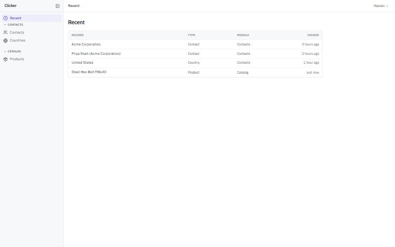 | 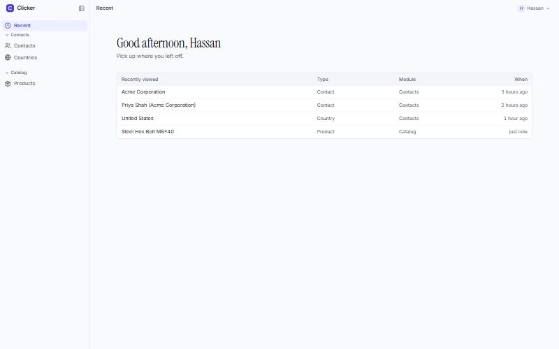 |
| List | 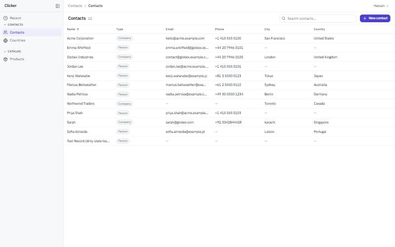 | 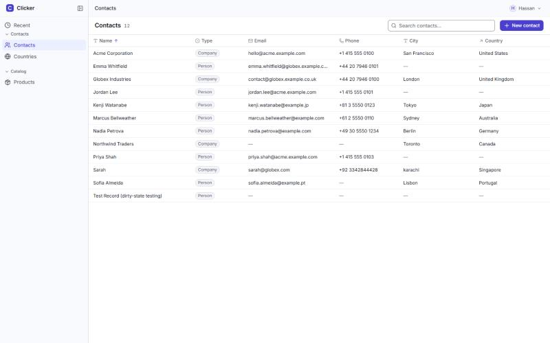 |
| Form | 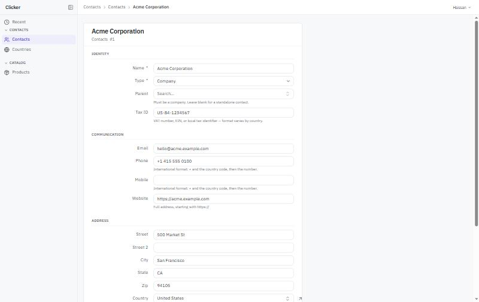 | 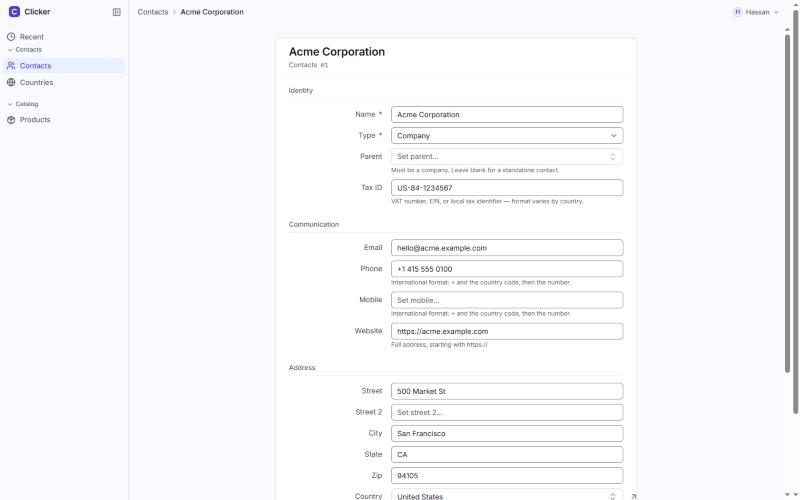 |
| Page and peek both unsaved | 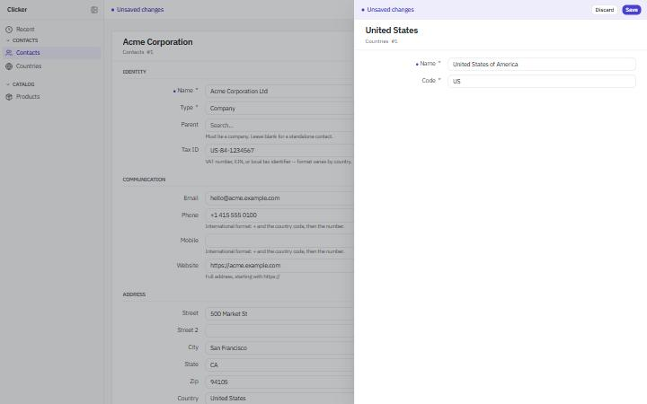 | 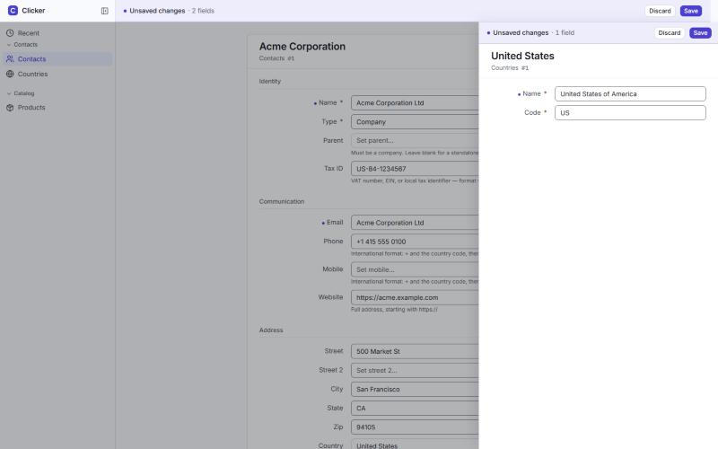 |
| Sign-in | 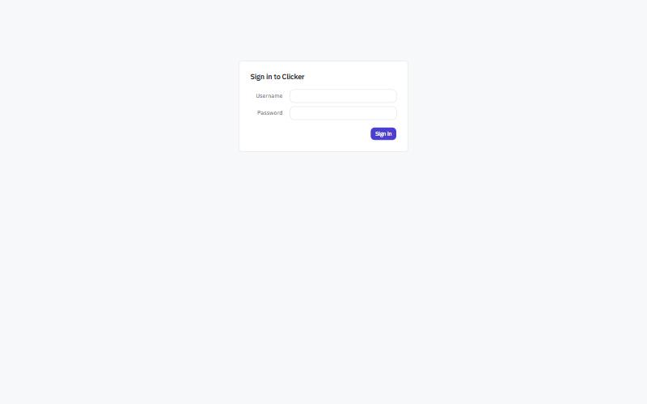 | 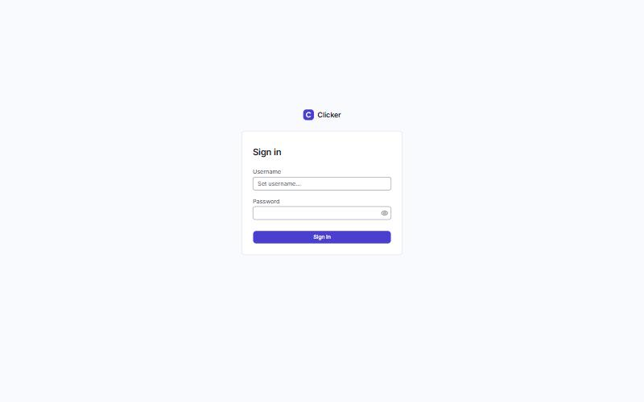 |
| 1024, list (before: last column clipped; after: on the rail, tooltip showing) | 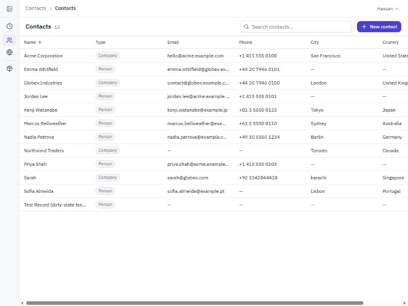 | 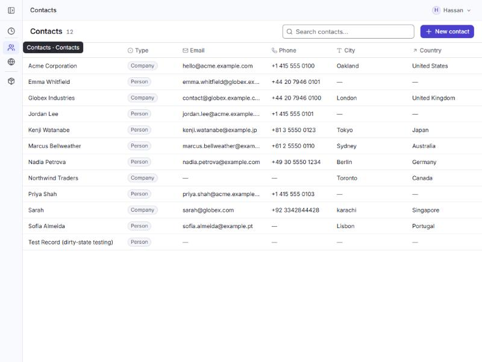 |
| 1024, Recents | 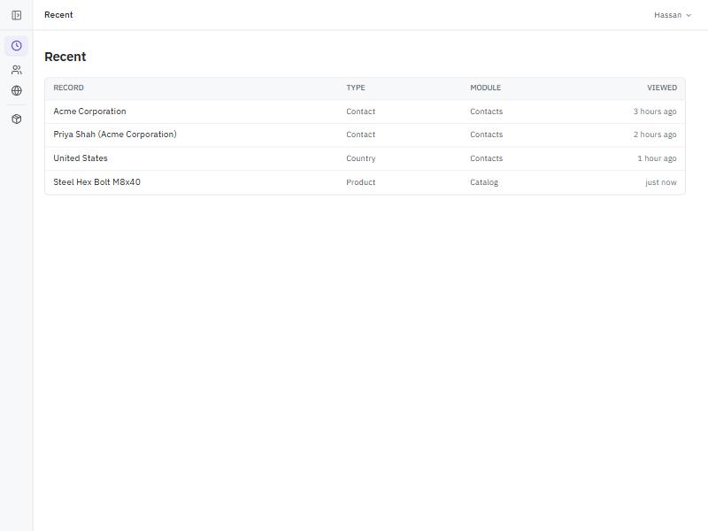 | 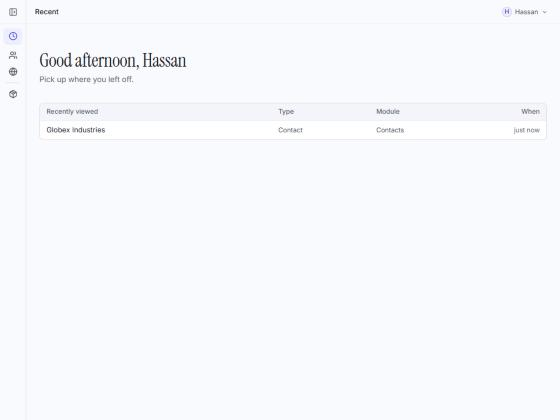 |

## Interaction sequence (checkpoint 2)

Stills, not a recording (the browser pane can't record, and transitions don't advance in it).

1. Row hover reveals actions: a pencil in the cell under the pointer, an "open as page" arrow at the row's end. `design/after/seq-1-row-hover-actions.jpg`
2. Click a row: a 480px peek opens, the list stays put, the open row is marked. `design/after/seq-2-peek-list-stays.jpg`
3. A failed inline edit rolls back and says why. `design/after/seq-3-inline-edit-rollback-toast.jpg`
4. Offline banner, and a stack of toasts including Undo. `design/after/seq-4-offline-banner-toast-stack.jpg`
5. Dark mode with a peek open. `design/after/1440-dark-list-peek.jpg`
6. The token gallery, light and dark. `design/after/1440-tokens-light-dark.jpg`
